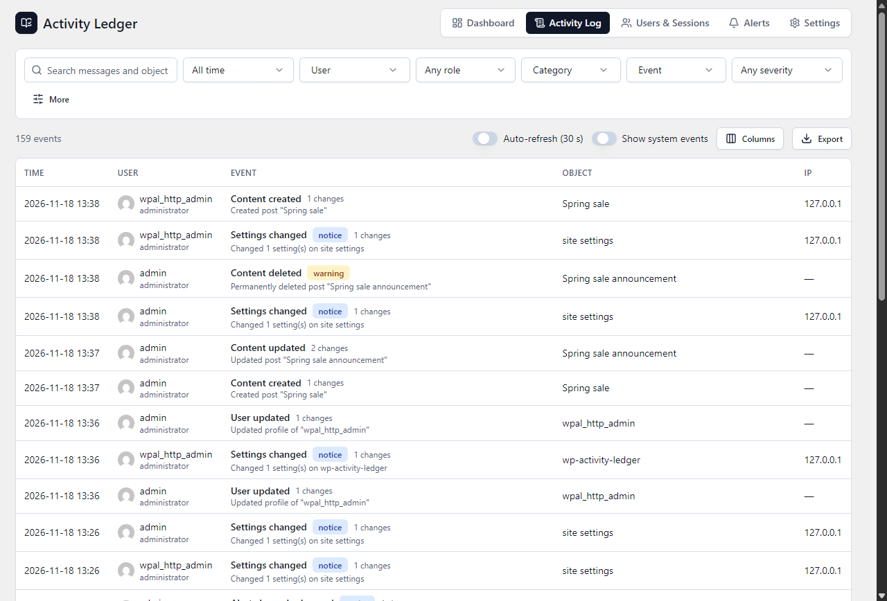
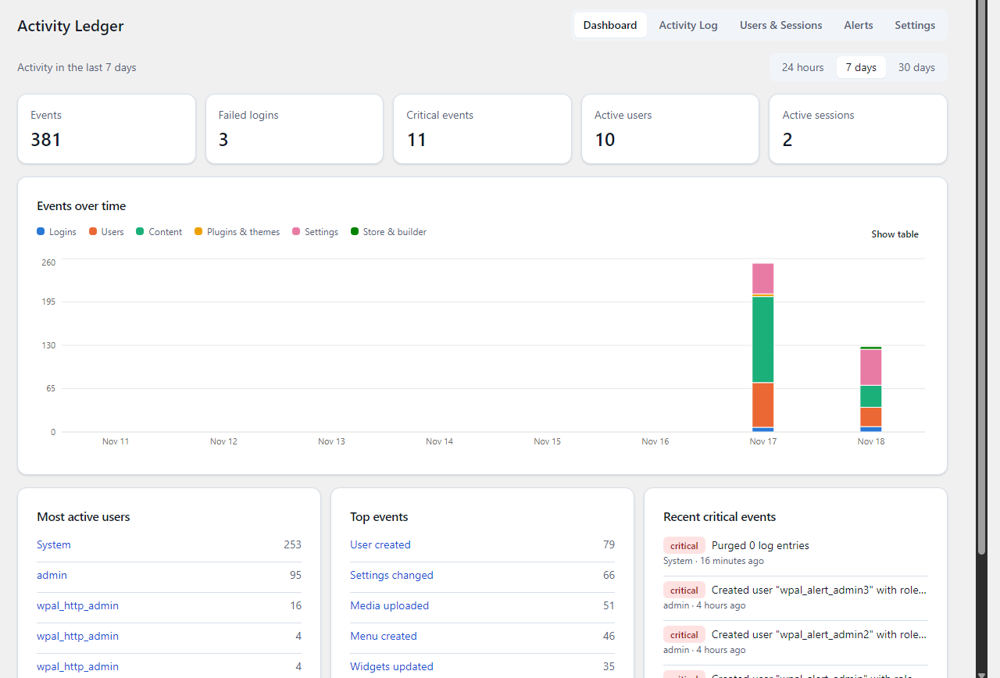
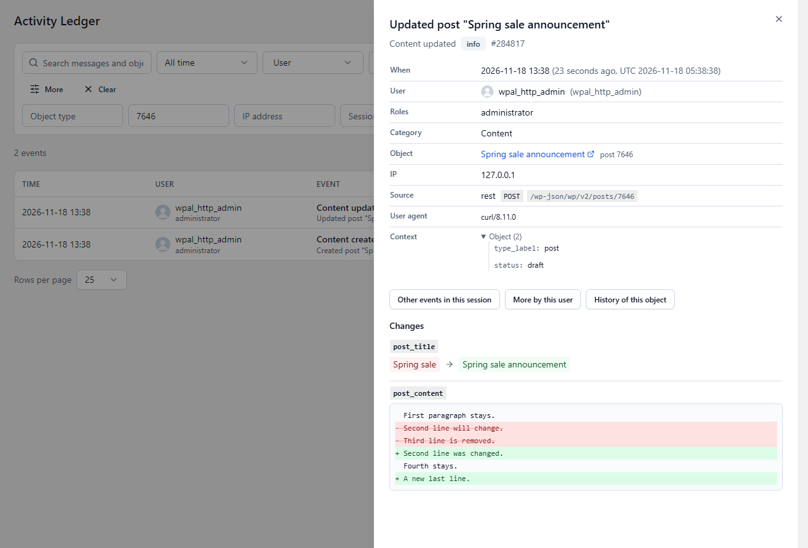
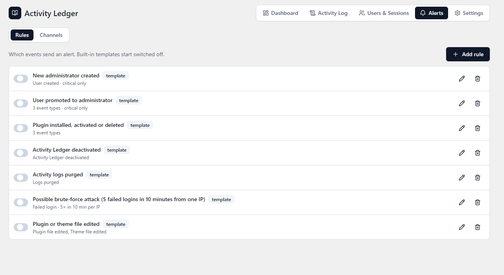
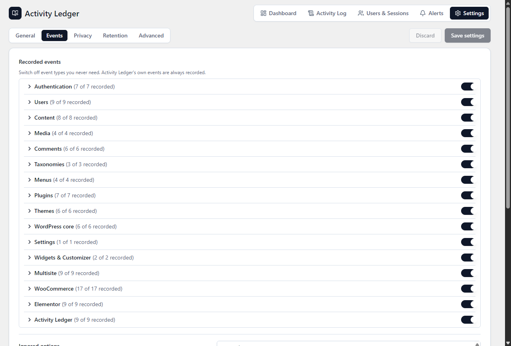

# WP Activity Ledger

An audit log for WordPress. It records who did what, when and from where, with field-level before/after values, and gives administrators a fast admin app to review, filter, export and get alerts on activity.



## Features

- **What it records**
  - Logins, logouts, failed logins (repeats are grouped) and password resets.
  - Users, roles and profiles.
  - Posts, pages and custom post types, media, comments, terms, menus, widgets and the Customizer.
  - Plugins, themes, core updates and auto-updates, file editor changes, and site settings.
  - WooCommerce orders, products, stock, coupons, settings and payment methods.
  - Elementor pages, templates, Site Settings and settings.
  - Network activity on multisite.
- **Field-level diffs:** each change stores the old and new value. Long text gets a line diff and arrays a tree view. Passwords, keys and tokens are stored as `[redacted]`.
- **Activity log:** filters (date range, user, role, category, event type, severity, object, IP, session, text) kept in the URL so views can be shared. A detail drawer, per-user column choice, and a 30-second auto-refresh.
- **System events:** routine events with no logged-in user (cron, WP-CLI, remote site managers) are hidden by default in the log, the dashboard and exports. System warnings and critical events (failed logins, purges) always show. Each user can turn on "Show system events", or pick "System" in the user filter to see them all.
- **Dashboard:** headline numbers, events over time by category (with a table view), top users and events, recent critical events that open in the detail drawer, and a widget on Dashboard → Home.
- **Users & sessions:** activity per user, active sessions with "Log out" and "Log out everywhere".
- **Alerts:** rules (event types, categories, severity, roles, "N times in M minutes per IP or user", cooldown) sent to email, signed webhooks, Slack, Discord or Microsoft Teams, in the background with retries. Seven built-in templates (new administrator, brute force, plugin changes…) ship switched off.
- **Export:** CSV or JSON of the current filters, streamed, any size.
- **Retention:** keep events for N days and/or at most N events. Old events are deleted daily in batches.
- **Privacy:** IP anonymisation, optional user agent storage, a trusted proxy header setting, and the WordPress personal data exporter and eraser (erasure anonymises the person's entries and keeps them as part of the audit trail).
- **Tamper protection:** events can't be edited. Purges, exports, settings changes and the plugin's own deactivation are logged, and purging needs a separate capability and a typed confirmation.
- **Multisite:** network activation, a log per site, network events in the main site's log, a network admin page with a site switcher, and an optional lock of site settings.
- **WP-CLI:** `wp activity-ledger list | show | stats | export | purge | prune | alerts`.

## Requirements

- PHP 8.1 or newer
- WordPress 6.5 or newer (single site or multisite)
- Optional: WooCommerce (HPOS compatible) and Elementor, for their activity

## Installation

1. Download `wp-activity-ledger-vX.Y.Z.zip` from the [latest release](https://github.com/slightgrey/wp-activity-ledger/releases/latest).
2. In WordPress go to **Plugins → Add New → Upload Plugin**, choose the zip and activate it. On multisite, **Network Activate** it to log every site.
3. Open **Activity Ledger** in the admin menu.

Updates appear on **Dashboard → Updates** like any other plugin: the plugin checks this repository's releases.

## Screens

| Dashboard | Event details |
|---|---|
|  |  |

| Alerts | Settings |
|---|---|
|  |  |

## Settings overview

**Activity Ledger → Settings** has five tabs:

- **General:** whose actions are recorded (every role or selected roles), excluded users, anonymous actions (failed logins), which roles may view or export the log, failed-login grouping, the dashboard widget.
- **Events:** switch off event types you don't need, and edit the ignored options, ignored meta keys and redacted fields (one pattern per line, `*` matches anything), plus the largest stored value.
- **Privacy:** anonymise IPs (IPv4 /24, IPv6 /48), store browser details, and the client IP source. Only choose a proxy header if your site is behind a proxy or CDN that sets it.
- **Retention:** days and maximum number of events, and **Purge logs** (type `PURGE` to confirm).
- **Advanced:** delete all data when the plugin is deleted. It's off by default, so the audit trail survives an uninstall.

### Capabilities

Administrators get all of them on activation:

| Capability | Allows |
|---|---|
| `wpal_view_logs` | Dashboard, activity log, users |
| `wpal_export_logs` | CSV/JSON export |
| `wpal_manage_settings` | Settings, alert rules and channels |
| `wpal_delete_logs` | Purging logs |
| `wpal_manage_sessions` | Ending other users' sessions (with `edit_user` on that user) |

On multisite, the network lock (**Network Admin → Activity Ledger → Network Settings**) takes `wpal_manage_settings` and `wpal_delete_logs` away from site administrators. They can still view their settings.

## WP-CLI

```bash
wp activity-ledger list --type=auth.login_failed --from=2026-01-01 --limit=50 --format=table
wp activity-ledger show 1234
wp activity-ledger stats --from=2026-01-01
wp activity-ledger export --format=csv --file=activity.csv --user=1
wp activity-ledger purge --before=2026-01-01 --yes   # or --all
wp activity-ledger prune                             # apply the retention settings now
wp activity-ledger alerts channels
wp activity-ledger alerts test <channel-id>

# Multisite: choose the site with --url
wp activity-ledger list --url=example.com/site2/
```

Dates are UTC (`Y-m-d` or `Y-m-d H:i:s`), except `purge --before`, which takes a day in the site's timezone.

## Alerts: verifying webhook signatures

Generic webhook channels send a JSON `POST` with two headers:

- `X-WPAL-Timestamp`: Unix time of the request.
- `X-WPAL-Signature`: `sha256=` + hex HMAC-SHA256 of `"{timestamp}.{raw body}"` with the channel's secret.

Check the signature against the raw body, and reject old timestamps:

```php
$body      = file_get_contents( 'php://input' );
$timestamp = (int) ( $_SERVER['HTTP_X_WPAL_TIMESTAMP'] ?? 0 );
$expected  = 'sha256=' . hash_hmac( 'sha256', $timestamp . '.' . $body, $secret );

if ( ! hash_equals( $expected, $_SERVER['HTTP_X_WPAL_SIGNATURE'] ?? '' ) || abs( time() - $timestamp ) > 300 ) {
	http_response_code( 401 );
	exit;
}

$alert = json_decode( $body, true ); // { version, type: "wpal.alert", rule, event: {…}, site: {…} }
```

```js
// Node.js (Express with express.raw({ type: 'application/json' }))
const crypto = require('crypto');
const expected = 'sha256=' + crypto.createHmac('sha256', secret).update(`${req.get('X-WPAL-Timestamp')}.${req.body}`).digest('hex');
const valid = crypto.timingSafeEqual(Buffer.from(expected), Buffer.from(req.get('X-WPAL-Signature') || ''));
```

## For developers

### Recording your own events

```php
// Anywhere after plugins_loaded. The type needs a "group.action" key.
wpal_log(
	'myplugin.invoice_sent',
	array(
		'object_type'  => 'invoice',
		'object_id'    => (string) $invoice_id,
		'object_label' => 'Invoice #' . $number,
		'context'      => array( 'amount' => $total ),
		'changes'      => array( 'status' => array( 'draft', 'sent' ) ), // field => [old, new]
	)
);

// Or without depending on the plugin being active:
do_action( 'wpal_log', 'myplugin.invoice_sent', array( /* same arguments */ ) );
```

Register a label, category and message for your types so the log and alerts can show them:

```php
add_filter(
	'wpal_event_types',
	static function ( array $types ): array {
		$types[] = new \WPActivityLedger\Domain\EventType(
			'myplugin.invoice_sent',
			\WPActivityLedger\Domain\Category::Content,
			\WPActivityLedger\Domain\Severity::Info,
			'Invoice sent',
			'Sent invoice {object}' // {object}, {user}, {type} and scalar context keys are filled in.
		);

		return $types;
	}
);
```

### Hooks

| Hook | Type | Purpose |
|---|---|---|
| `wpal_log` | action | Record an event: `( string $event_type, array $args )`. |
| `wpal_should_log_event` | filter | `( bool $log, Event $event, string $source )`: return false to skip an event (`$source`: web, admin, ajax, rest, cron, cli, xmlrpc). |
| `wpal_event_before_save` | filter | `( Event $event )`: change an event before it is buffered, or return anything else to drop it. |
| `wpal_events_flushed` | action | `( Event[] $events )`: after a batch was stored (alerts listen here). |
| `wpal_event_repeated` | action | `( Event $event )`: a repeated event updated its earlier row (folded failed logins). |
| `wpal_event_types` | filter | Add or change event type definitions. |
| `wpal_sensors` | filter | Add, replace or remove sensors (`SensorInterface`). |
| `wpal_integrations` | filter | Add integrations (`IntegrationInterface`: `slug`, `name`, `is_available`, `register`, `event_types`). |
| `wpal_register` | action | `( Loader $loader )`: queue your own hooks with the plugin's loader. |
| `wpal_ignored_option_patterns` | filter | Option name patterns that are never recorded. |
| `wpal_ignored_meta_keys` | filter | Post/user meta key patterns that are never recorded. |
| `wpal_tracked_private_meta` | filter | Private (`_`-prefixed) post meta keys that should be recorded. |
| `wpal_option_is_claimed` | filter | `( bool $claimed, string $option )`: true when your code records an option itself. |
| `wpal_record_cron_option_changes` | filter | Record option changes made by WP-Cron (off by default). |
| `wpal_post_sensor_skip_types` | filter | Post types the content sensor ignores. |
| `wpal_object_edit_link` | filter | `( ?string $link, string $object_type, string $object_id )`: edit link of an event's object. |
| `wpal_woocommerce_staff_edit` | filter | `( bool $staff, string $capability )`: whether WooCommerce saves in this request are staff edits. |

### REST API

Namespace `wpal/v1`, cookie or application-password authentication: `/events`, `/events/{id}`, `/stats`, `/meta`, `/users`, `/users/{id}/sessions`, `/settings`, `/alerts/channels`, `/alerts/rules`, `/purge`, `/me/prefs`, and on multisite `/sites` and `/network-settings`. Each route checks the capability above.

### Building from source

```bash
composer install && npm install
npm run build             # admin app → dist/admin
composer lint             # PHPCS (WordPress coding standards)
composer analyse          # PHPStan level 6
composer test             # unit tests
composer test:integration # integration tests against a local WordPress with the plugin active
npm run lint && npm test  # ESLint and Vitest for the admin app
php scripts/build-zip.php # release zip
```

Integration tests run inside a database transaction that is rolled back. For a multisite run, point them at a network: `WPAL_TEST_ROOT=/path/to/network WPAL_TEST_HOST=example.test WPAL_TEST_PATH=site2/ composer test:integration`.

Translations: strings use the `wp-activity-ledger` text domain. `languages/wp-activity-ledger.pot` is generated with `wp i18n make-pot . languages/wp-activity-ledger.pot --exclude=node_modules,vendor,dist,tests,scripts`. Admin app translations come from the JSON files `wp i18n make-json` writes.

## License

GPL-2.0-or-later. See [LICENSE](LICENSE).
